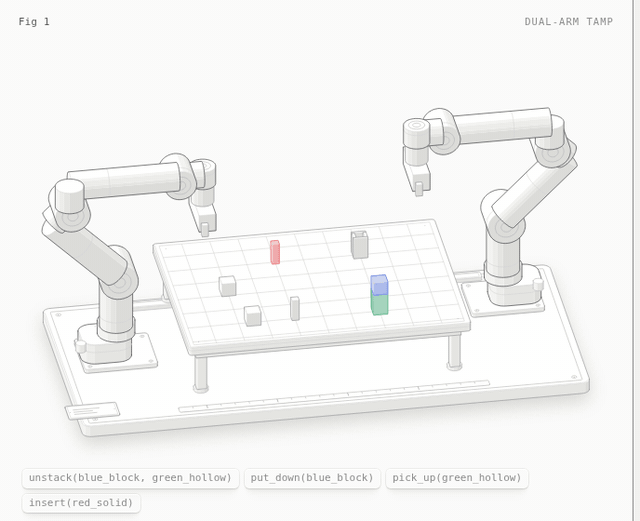

# Dual-Arm Peg-in-Hole with Task and Motion Planning

   

Two Franka Emika Panda arms work together in Gazebo to insert a peg into a hollow block. A symbolic task planner decides *what* to do, such as clearing a block that sits on top of the target first. MoveIt then plans *how* each arm moves.



In this run, Panda 2 lifts the blue block off `green_hollow`, puts it down, and picks up `green_hollow`. Panda 1 then inserts `red_solid` into it.

ASEN 5254 Algorithmic Motion Planning, University of Colorado Boulder. Author: Allen Devaraj Augustin Ponraj.

## How it works

- **Task planning:** `task_manager.py` stores the world state as predicates (`on`, `on_table`, `clear`, `holding`, `hand_empty`). From that state it builds a plan of actions (`unstack`, `put_down`, `pick_up`) that gets the hollow block into the holding arm's gripper. If the hollow block is not clear, the plan removes whatever is on it first. The insertion then runs as its own step.
- **Motion planning:** RRTConnect (OMPL, through MoveIt) moves the arms around obstacles. A Cartesian path does the final straight-line insertion.
- **Insertion frames:** the peg's target pose is computed through the chain `World → hollow block → insertion frame → peg → gripper`. This lets the insertion work at whatever angle the holding arm presents the block.
- **Object poses:** taken from Gazebo ground truth through `ros_gz_bridge`.

## Requirements

Ubuntu 22.04, ROS 2 Humble, Ignition Gazebo Fortress (6.17+) and MoveIt 2.

```bash
sudo apt install ros-humble-moveit ros-humble-ros-gz ros-humble-ros2-control \
                 ros-humble-ros2-controllers python3-tk
pip3 install scipy numpy
```

## Build and run

```bash
git clone https://github.com/AllenDevaraj/ASEN-5254-Project.git
cd ASEN-5254-Project/ros2_ws
colcon build --symlink-install
source install/setup.bash
ros2 launch pick_and_place dual_panda_single_group.launch.py
```

The launch file starts Gazebo, MoveIt and the **Unified Dual Panda Control** window. In that window:

1. Under **Global Controls**, click **Move Both to Neutral**.
2. Under **Dual Arm Tasks**, choose the peg for Panda 1 (inserter) and the hollow block for Panda 2 (holder).
3. Click **Insert Prep**. The task planner runs, and Panda 2 clears and picks up the hollow block.
4. Click **Insert**. Panda 1 carries out the Cartesian approach and inserts the peg.

The **Panda 1** and **Panda 2** panels move each arm on its own (**Move** or **Plan Only**). The **Live Monitor** shows the live end-effector poses.

## Layout

```
ros2_ws/src/pick_and_place/         launch file, control GUI, task planner, Gazebo models
ros2_ws/src/panda_ign_description/  Panda URDF, controllers, world
ros2_ws/src/pick_and_place_msgs/    message definitions
docs/figure/                        README figure
```

## License

MIT
